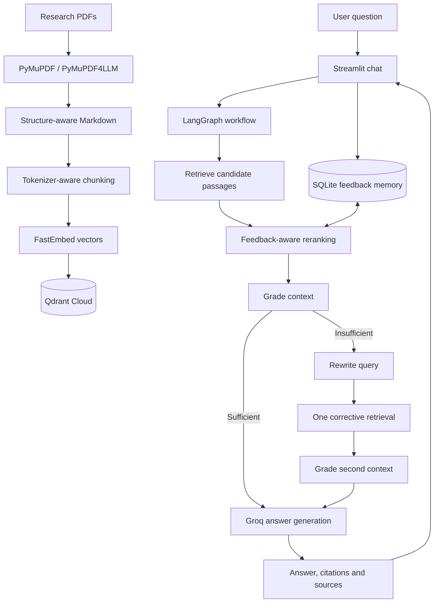
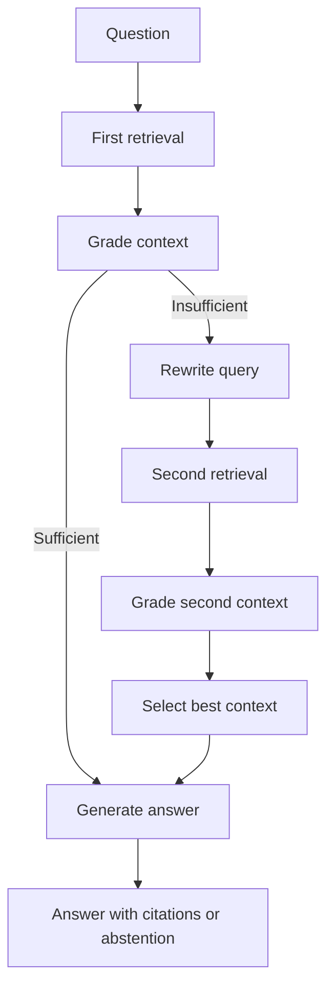

# AdaptiveRAG — Feedback-Driven Research Paper Assistant

AdaptiveRAG is a conversational assistant for five research papers about retrieval-augmented generation and dense retrieval. It combines semantic search, grounded answer generation, persistent user feedback and a controlled corrective-retrieval workflow.

**Core idea:** historical feedback from sufficiently similar questions can make a small, bounded adjustment to future passage rankings. Semantic similarity remains the primary ranking signal. The project does not train or fine-tune its embedding model.

## Features

- PDF text extraction with PyMuPDF and PyMuPDF4LLM.
- Tokenizer-aware, overlapping chunks with paper, section and page metadata.
- 384-dimensional embeddings using FastEmbed and `BAAI/bge-small-en-v1.5`.
- Vector search using Qdrant Cloud.
- Grounded answer generation and citations using Groq.
- SQLite persistence for answers, retrieved chunk IDs and answer-level feedback.
- Query-aware, bounded feedback reranking.
- LangGraph context grading, one corrective query rewrite/retrieval retry, and abstention when evidence remains insufficient.
- Streamlit conversational UI with citations, feedback and retrieval inspection.
- Baseline vs adaptive retrieval evaluation.

## Architecture



## How retrieval works

### Baseline
1. Embed the question with the BGE query instruction prefix.
2. Search Qdrant for nearest passage vectors.
3. Pass the selected passages and source metadata to the answer-generation workflow.

### Adaptive ranking
1. Retrieve a broader candidate set than the final top-k.
2. For each candidate chunk, inspect historical answers in which it appeared.
3. Compare the current query with historical queries using a lightweight token-overlap/Jaccard-style similarity.
4. Require a minimum amount of qualifying feedback evidence.
5. Apply a bounded feedback adjustment, then rank using the adjusted score.

Conceptually:

```text
adjusted_score = original_similarity + bounded_feedback_adjustment
```

Current intended safeguards:
- `FEEDBACK_MAX_ADJUSTMENT=0.08`
- `FEEDBACK_MIN_EVIDENCE=2`
- `FEEDBACK_MIN_QUERY_SIMILARITY=0.25`

The values are tunable heuristics, not universally optimal constants. Feedback is secondary to semantic similarity.

### Feedback reasons

| User feedback | Effect on retrieval ranking |
|---|---|
| Helpful | Weak positive evidence about the retrieved set |
| Retrieved passages were irrelevant | Negative retrieval signal |
| Important information was missing | Not treated as proof that existing chunks were irrelevant |
| Answer was incorrect | Not treated as proof that retrieval failed; generation may be at fault |

Feedback is answer-level, not passage-level. This is a natural, low-friction user experience, but attribution is noisy: a rating applies to the answer/retrieved set, not necessarily every passage. Query similarity, minimum evidence and bounded adjustments reduce but do not eliminate this limitation.

## Corrective retrieval with LangGraph



The graph grades the first retrieved context. If it appears insufficient, an LLM rewrites the query and the retriever runs once more. The graph selects the better available context. If evidence is still insufficient, the system abstains rather than inventing an answer.

One retry bounds latency and LLM cost and prevents uncontrolled loops. The grader's confidence is an LLM estimate, not a calibrated probability.

## Latest evaluation

The latest reported run:

| Metric | Baseline | Adaptive | Difference |
|---|---:|---:|---:|
| Recall@5 (paper-level) | 0.8000 | 0.8200 | +0.0200 |
| MRR (paper-level) | 0.8400 | 0.8200 | -0.0200 |
| Average latency | 0.4161 s | 0.3984 s | -0.0177 s |

Interpretation:
- Paper-level Recall@5 increased by 0.02 (2 percentage points).
- Paper-level MRR decreased by 0.02.
- Average measured latency was 0.0177 seconds lower in this run.
- These are small, mixed results. They do not establish that adaptive retrieval is universally better.
- Latency is a single observed average; repeated runs and percentiles are needed before making a performance claim.

**Metric caveat:** the current evaluation labels relevant paper IDs, not relevant chunk IDs. These values should therefore be described as paper-level coverage and paper-level reciprocal rank, not standard chunk-level Recall@5/MRR. Improve the dataset with chunk-level relevance labels before making stronger retrieval-quality claims.

Run:

```powershell
python scripts/evaluate_retrieval.py
```

Detailed results are written to `data/evaluation/retrieval_results.json`.

## Tech stack

- Python 3.12, Streamlit
- LangGraph
- Groq LLM inference
- FastEmbed — `BAAI/bge-small-en-v1.5` (384 dimensions)
- Qdrant Cloud
- PyMuPDF, PyMuPDF4LLM
- SQLite
- Transformers tokenizer utilities

The current Streamlit MVP calls the Python services directly. FastAPI dependencies may be present in the environment, but the current UI flow does not require a separately deployed API.

## Repository structure

```text
adaptive-rag/
├── backend/
│   ├── database/       # SQLite answer and feedback persistence
│   ├── embeddings/     # FastEmbed wrapper
│   ├── graph/          # LangGraph workflow
│   ├── ingestion/      # PDF extraction and chunking
│   ├── retrieval/      # Qdrant, retriever and feedback ranker
│   └── services/       # RAG answer generation
├── data/
│   ├── papers/         # Source PDFs
│   ├── processed/      # Extracted Markdown and chunks
│   └── evaluation/     # Evaluation questions and results
├── frontend/
│   └── app.py
├── scripts/            # Ingestion, testing and evaluation commands
├── tests/
├── .env.example
├── .gitignore
├── requirements.txt
└── README.md
```

## Setup (Windows PowerShell)

### 1. Clone and create a virtual environment

```powershell
git clone <YOUR_GITHUB_REPOSITORY_URL>
cd adaptive-rag

py -3.12 -m venv .venv
.\.venv\Scripts\Activate.ps1

python -m pip install --upgrade pip
pip install -r requirements.txt
```

### 2. Configure secrets

```powershell
Copy-Item .env.example .env
```

Fill in your own credentials:

```env
GROQ_API_KEY=your_groq_api_key
LLM_MODEL=llama-3.3-70b-versatile

QDRANT_URL=your_qdrant_cloud_url
QDRANT_API_KEY=your_qdrant_api_key
QDRANT_COLLECTION=adaptive_rag

EMBEDDING_MODEL=BAAI/bge-small-en-v1.5
DATABASE_URL=sqlite:///./adaptive_rag.db

FEEDBACK_MAX_ADJUSTMENT=0.08
FEEDBACK_MIN_EVIDENCE=2
FEEDBACK_MIN_QUERY_SIMILARITY=0.25
```

Never commit `.env`, API keys, virtual environments or local database files.

### 3. Download the five source PDFs

Place the PDFs in `data/papers/`:

1. [Retrieval-Augmented Generation for Knowledge-Intensive NLP Tasks](https://arxiv.org/abs/2005.11401)
2. [Dense Passage Retrieval for Open-Domain Question Answering](https://arxiv.org/abs/2004.04906)
3. [ColBERT: Efficient and Effective Passage Search via Contextualized Late Interaction over BERT](https://arxiv.org/abs/2004.12832)
4. [Precise Zero-Shot Dense Retrieval without Relevance Labels (HyDE)](https://arxiv.org/abs/2212.10496)
5. [Automated Evaluation of Retrieval Augmented Generation (RAGAS)](https://arxiv.org/abs/2309.15217)

### 4. Ingest and index

```powershell
python scripts/extract_papers.py
python scripts/chunk_papers.py
python scripts/ingest_to_qdrant.py
```

### 5. Run the chatbot

```powershell
streamlit run frontend/app.py
```

Open the local URL printed by Streamlit, normally `http://localhost:8501`.

### 6. Run retrieval evaluation

```powershell
python scripts/evaluate_retrieval.py
```

## Current limitations

- Answer-level feedback is weak supervision for the retrieved set, not direct relevance labels for individual chunks.
- The feedback ranker is heuristic; it does not train embedding representations.
- Query similarity is based on token overlap and may miss semantic paraphrases.
- Evaluation is relatively small and paper-level, not chunk-level.
- Latest evaluation results are mixed: Recall@5 improves slightly while MRR decreases slightly.
- LLM grading and query rewriting add cost and latency.
- The current application is a fixed-corpus MVP; the Streamlit app calls Python services directly.

## Roadmap: improvements that solve real problems

1. **Chunk-level evaluation labels:** label relevant passages, then calculate meaningful passage Recall@k, MRR and nDCG.
2. **Ablation and repeated evaluation:** compare baseline, adaptive reranking and corrective retry separately; report median/p95 latency.
3. **Hybrid retrieval (BM25 + dense):** useful for exact technical terms, acronyms, paper names and equations. Combine ranked lists with Reciprocal Rank Fusion and measure the benefit.
4. **Cross-encoder reranking:** test only if retrieval quality remains weak; compare relevance gain against extra latency.
5. **Feedback attribution improvements:** keep the simple thumbs-up/down UX, but avoid using feedback reasons that point to generation or missing coverage as evidence of irrelevant retrieval.
6. **Ingestion quality checks:** detect empty pages, duplicate headers, malformed chunks, missing metadata and duplicate documents.
7. **Production backend:** add FastAPI endpoints, authentication, per-user data isolation, rate limits, structured logs, timeouts and health checks if deploying to multiple users.
8. **Incremental indexing:** track paper versions and re-index only changed documents.

Avoid adding agents, fine-tuning, knowledge graphs or more vector databases unless a demonstrated requirement and evaluation justify them.

## Interview positioning

> Built a feedback-driven RAG assistant over research papers using FastEmbed and Qdrant for semantic retrieval, Groq for grounded answer generation, SQLite for persistent interaction feedback, and LangGraph for a one-retry corrective retrieval workflow. Implemented query-aware bounded feedback reranking and evaluated it against baseline retrieval using a manually labelled question set.

Be transparent about the latest measurements: paper-level Recall@5 moved from 0.80 to 0.82, paper-level MRR moved from 0.84 to 0.82, and average measured latency moved from 0.4161s to 0.3984s. Explain that these are early mixed results and describe the next evaluation improvements.

## License

Choose and add a license before presenting the repository as open source.
